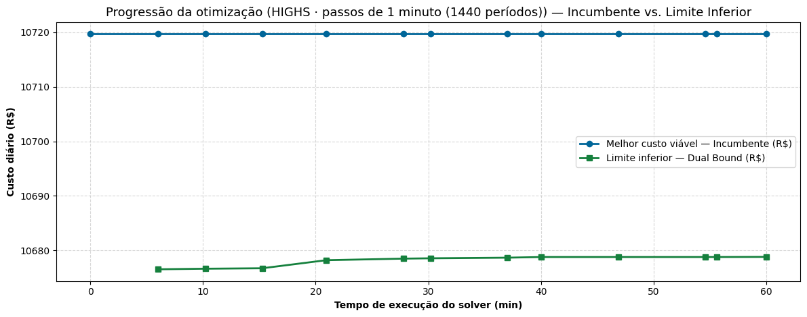
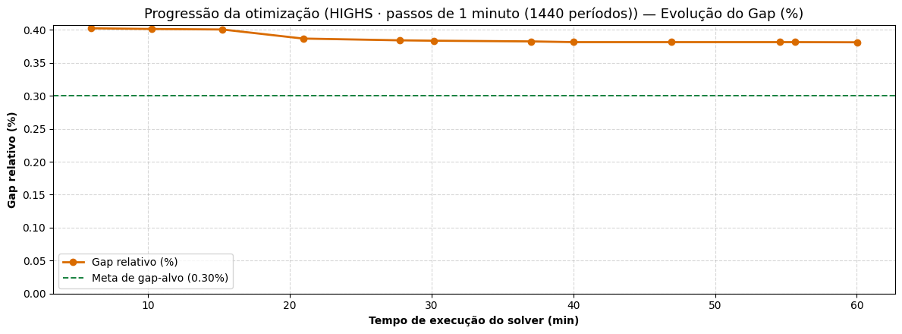
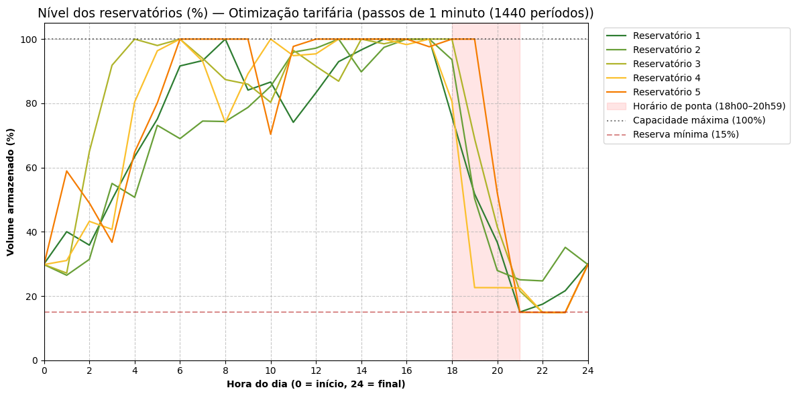
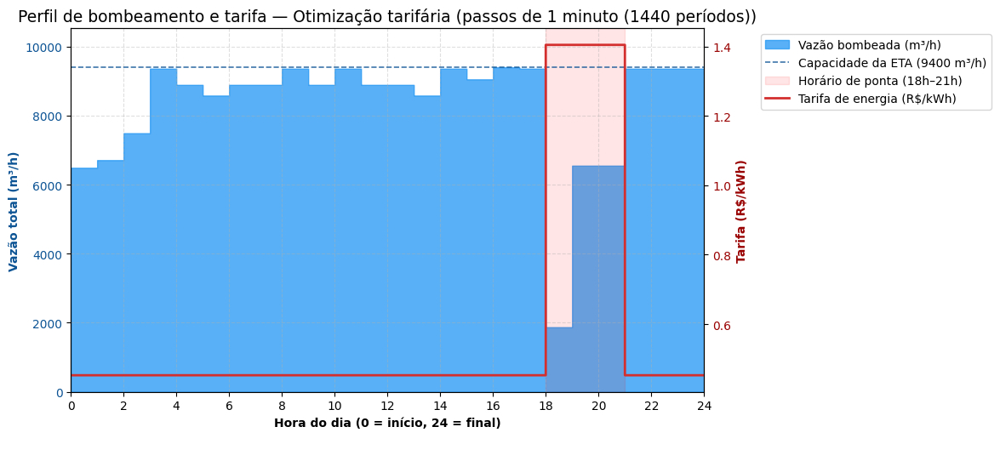

# Análise Comparativa de Solvers e Estratégias de Aceleração MILP no Agendamento Operacional de Bombas de uma ETA

**Projeto:** Otimização Operacional do Agendamento de Bombas e Distribuição de Água Tratada via Programação Linear Inteira Mista (MILP)  
**Disciplina:** MAI5032 — Tópicos em Pesquisa Operacional (MECAI / ICMC-USP, 2026)  
**Autores:** Felipe de Mattos Bracale · Jheimis Fernandes Marques · Luciano Severino da Silva

---

## Resumo

Este estudo compara o desempenho computacional de três *solvers* de Programação Linear Inteira Mista (MILP) — **HiGHS**, **CBC** e **Gurobi** — acionados por duas bibliotecas de modelagem em Python (**Pyomo** e **python-mip**), na resolução do problema de agendamento operacional de motobombas de uma Estação de Tratamento de Água (ETA) sob tarifa horossazonal. Avaliam-se duas resoluções temporais: um modelo **horário** (24 períodos; 144 variáveis binárias) e um modelo **minuto a minuto** (1.440 períodos; 8.640 variáveis binárias). No modelo horário, todos os *solvers* atingem a otimalidade dentro da tolerância de 0,3% em menos de 90 segundos, com destaque para **Pyomo/Gurobi (2,02 s)** e **python-mip/CBC (4,96 s)**. Ao refinar o horizonte para 1 minuto, a busca a frio (*cold start*) sofre forte degradação pela simetria combinatória intra-hora, encerrando 1 hora de execução com *gaps* entre **2,24%** (HiGHS) e **3,84%** (CBC). A combinação de uma **formulação enxuta** (−34,8% de restrições antes do *presolve*) com uma estratégia de ***warm start* hierárquico** (projeção da solução horária para 1.440 minutos) reduz o *gap* final em até **82%**: já em **5 minutos**, o HiGHS (tanto em Pyomo quanto em python-mip) alcança custo diário de **R$ 10.719,69** com *gap* de **0,40%** (caindo para **0,38%** em 1 hora), superando amplamente 1 hora de *cold start* e gerando uma economia conservadora de **R$ 1.356,32/dia (11,23%)** sem redução no atendimento à demanda.

---

## 1. Contexto e Configuração Experimental

O problema consiste em determinar, ao longo de um horizonte diário de 24 horas, o estado de acionamento (ligado/desligado) e a vazão contínua de motobombas, os fluxos nos arcos de recalque e gravidade e o volume armazenado em reservatórios, minimizando o custo diário de energia elétrica. A sub-rede foi calibrada com base em dados do SINISA 2024 e do PMSB de Santos (cenário de estresse de verão litorâneo):

- **Topologia:** 1 ETA (limite agregado de 9.400 m³/h), 6 motobombas, 5 reservatórios (capacidade útil total de 39.900 m³, volume inicial de 30% e reserva mínima obrigatória de 15%), 12 setores urbanos, 10 arcos bomba → reservatório e 18 arcos reservatório → setor.
- **Demanda e tarifa:** demanda diária total de **199.488 m³/dia** (média de 8.312 m³/h; pico horário de 17.663 m³/h às 18h); tarifa fora de ponta de **R$ 0,4525/kWh** e tarifa de ponta de **R$ 1,4048/kWh** entre 18h00 e 20h59 (**3,1×** mais cara).
- **Critério de parada:** tolerância de otimalidade relativa (`mip_rel_gap`) fixada em **0,30%** e limites de tempo de **300 s (5 min)** e **3.600 s (1 h)**.

A Tabela 1 resume o porte das três variantes modeladas. O *solver* comercial **Gurobi** foi avaliado apenas no modelo horário, pois a instância de 1.440 períodos ultrapassa o limite de variáveis/restrições da licença gratuita de avaliação.

| Variante do modelo | Períodos ($\Delta t$) | Variáveis binárias | Variáveis contínuas | Total de variáveis | Restrições |
|---|---:|---:|---:|---:|---:|
| Horário (base) | 24 (60 min) | 144 | 936 | 1.080 | 1.109 |
| Minuto a minuto — Formulação Base | 1.440 (1 min) | 8.640 | 56.160 | 64.800 | 66.245 |
| Minuto a minuto — Formulação Enxuta | 1.440 (1 min) | 8.640 | 47.520 | 56.160 | 43.200 |

> **Nota sobre a Formulação Enxuta:** a eliminação das variáveis explícitas de vazão total por bomba ($q_{p,t}$, substituídas diretamente por expressões lineares dos fluxos $f^{PR}_{p,r,t}$) e a transferência dos limites mínimo, máximo e de recuperação final dos reservatórios para os *bounds* diretos de $V_{r,t}$ removem **8.640 variáveis** e **23.045 restrições redundantes (−34,8%)** antes mesmo da etapa de *presolve* do *solver*, preservando integralmente a região viável e o valor ótimo do problema.

*Ressalva de reprodutibilidade:* os tempos reportados refletem execuções reais em ambiente local e podem variar conforme hardware, carga do sistema operacional e versões das bibliotecas (`Pyomo 6.11`, `python-mip 2.0`, `HiGHS 1.16`, `CBC`).

---

## 2. Comparação no Modelo Horário (24 Períodos)

No horizonte de 24 intervalos de 1 hora, todos os cinco pares **Modelador / Solver** atingiram solução ótima dentro da tolerância de 0,30% bem abaixo do limite de 300 segundos.

| Modelador / Solver | Tempo (s) | Status | Custo incumbente (R$) | Limite inferior (R$) | Gap final | Nós explorados |
|---|---:|---|---:|---:|---:|---:|
| Pyomo / Gurobi | **2,02** | Ótimo (≤ 0,3%) | 10.738,27 | 10.707,73 | 0,28% | 8.464 |
| python-mip / CBC | **4,96** | Ótimo (≤ 0,3%) | **10.724,22** | 10.700,27 | 0,22% | — |
| python-mip / HiGHS | 23,01 | Ótimo (≤ 0,3%) | 10.728,74 | 10.697,37 | 0,29% | — |
| Pyomo / HiGHS | 27,18 | Ótimo (≤ 0,3%) | 10.733,27 | 10.701,07 | 0,30% | — |
| Pyomo / CBC | 86,98 | Ótimo (≤ 0,3%) | **10.724,22** | 10.701,30 | **0,21%** | 11.020 |

### Principais achados no modelo horário

1. **Consistência das soluções:** todas as execuções convergiram para a mesma faixa de custo diário (**R$ 10.724,22 a R$ 10.738,27**, variação de apenas 0,13%), compatível com o critério de parada de 0,30%. O limite inferior situa-se de forma consistente em torno de **R$ 10.700**.
2. **Impacto da interface de modelagem no CBC:** embora `Pyomo / CBC` e `python-mip / CBC` tenham alcançado exatamente a mesma incumbente (**R$ 10.724,22**), o `python-mip` foi **17,5× mais rápido** (4,96 s vs. 86,98 s). Isso decorre da integração direta em memória via CFFI/C API do `python-mip` com a biblioteca nativa do CBC (incluindo sua configuração padrão de cortes e heurísticas), em contraste com o *overhead* de serialização em arquivo e parâmetros padrão do executável externo acionado pelo Pyomo.
3. **Estabilidade do HiGHS entre interfaces:** o HiGHS apresentou comportamento muito semelhante em ambas as bibliotecas (23,01 s no `python-mip` vs. 27,18 s no `Pyomo`), indicando que o custo computacional domina o *overhead* de modelagem.
4. **Velocidade como viabilizador do *Warm Start*:** o fato de a instância horária ser resolvida até 0,3% de otimalidade em poucos segundos torna-a um excelente gerador de solução inicial viável para o modelo minuto a minuto.

---

## 3. Escalabilidade para o Modelo Minuto a Minuto: *Cold Start* (1.440 Períodos)

Ao aumentar a resolução temporal em 60× (de 24 para 1.440 períodos), o número de variáveis binárias sobe de 144 para **8.640**. Como a demanda e a tarifa permanecem constantes dentro de cada bloco de 60 minutos, surge uma **simetria combinatória severa**: permutar minutos ligados e desligados de uma mesma bomba dentro de uma hora gera milhares de soluções com exatamente o mesmo custo, dificultando a poda da árvore *Branch-and-Bound*.

### 3.1 Execuções *Cold Start* com limite de 300 s (5 minutos)

| Modelador / Solver | Tempo observado (s) | Status | Custo incumbente (R$) | Limite inferior (R$) | Gap final | Nós explorados |
|---|---:|---|---:|---:|---:|---:|
| python-mip / HiGHS | 300,23 | Limite de tempo | **11.069,08** | 10.676,56 | **3,55%** | — |
| Pyomo / HiGHS | 301,49 | Limite de tempo | 11.272,83 | 10.676,55 | 5,29% | 1 |
| Pyomo / CBC | 333,03 | Limite de tempo | 11.697,07 | 10.692,50 | 8,59% | 4 |
| python-mip / CBC | 330,48 | Limite de tempo | 11.972,94 | **10.692,62** | 10,69% | — |

### 3.2 Execuções *Cold Start* com limite de 3.600 s (1 hora)

| Modelador / Solver | Tempo reportado (s) | Status | Custo incumbente (R$) | Limite inferior (R$) | Gap final | Nós explorados |
|---|---:|---|---:|---:|---:|---:|
| Pyomo / HiGHS | 3.600,10 | Limite de tempo | **10.923,72** | 10.678,57 | **2,24%** | — |
| python-mip / HiGHS | 3.624,22 | Limite de tempo | 10.931,02 | 10.677,65 | 2,32% | — |
| python-mip / CBC | 1.595,81\* | Limite de tempo | 11.054,51 | **10.692,62** | 3,27% | — |
| Pyomo / CBC | 2.644,99\* | Limite de tempo | 11.119,73 | 10.692,50 | 3,84% | 14.262 |

*\*Nota sobre o tempo reportado pelo CBC em limite de 1 h:* em execuções *multithread*, o contador interno de tempo de CPU do CBC pode divergir do tempo de relógio (*wall-clock*) e acionar o encerramento por `maxTimeLimit` antes de completar 3.600 s de relógio.

### Diagnóstico do comportamento em *Cold Start*

- **Superioridade primal do HiGHS:** tanto em 5 min quanto em 1 h, o HiGHS obteve soluções incumbentes significativamente melhores que o CBC. Em 1 hora, `Pyomo / HiGHS` atingiu **R$ 10.923,72 (gap 2,24%)**, praticamente empatado com `python-mip / HiGHS` (**R$ 10.931,02; gap 2,32%**), enquanto o CBC permaneceu acima de R$ 11.050 (gaps de 3,27% a 3,84%).
- **Superioridade dual na raiz do CBC:** um detalhe técnico relevante é que o CBC produziu um limite inferior ligeiramente mais apertado já no nó raiz (**R$ 10.692,50–10.692,62** vs. **R$ 10.676,55–10.678,57** do HiGHS), fruto de seus geradores de planos de corte na relaxação inicial. Contudo, suas heurísticas primais tiveram maior dificuldade para encontrar soluções viáveis baratas sem inicialização.
- **Limitação operacional do *Cold Start*:** mesmo após 1 hora completa, nenhuma combinação *cold start* conseguiu baixar o *gap* abaixo de 2%, desperdiçando dezenas de minutos navegando a simetria intra-hora (em 5 min, HiGHS e CBC ainda estavam entre 1 e 4 nós da árvore).

---

## 4. Aceleração com Formulação Enxuta e *Warm Start* Hierárquico

Para superar o gargalo da simetria sem comprometer a exatidão do modelo, aplicou-se uma estratégia em duas frentes nos notebooks otimizados:

1. **Formulação Enxuta:** eliminação de 8.640 variáveis $q_{p,t}$ (via `Expression` em Pyomo e substituição direta em `python-mip`) e aplicação dos limites de $V_{r,t}$ nos *bounds* das variáveis, reduzindo as restrições de 66.245 para 43.200 (−34,8%).
2. ***Warm Start* Hierárquico (Agregação → Desagregação):** resolve-se primeiro o modelo horário (144 binárias) em poucos segundos e projeta-se cada decisão horária para os seus 60 minutos correspondentes. Como demanda e tarifa são constantes dentro da hora, qualquer solução viável do modelo horário pertence ao conjunto viável do modelo minuto a minuto ($\mathcal{F}_{\text{hora}} \subset \mathcal{F}_{\text{min}}$), garantindo **100% de viabilidade** na injeção (`warmstart=True` / `model.start`).

Dentro do algoritmo *Branch-and-Cut*, essa incumbente inicial $U_0$ produz dois efeitos imediatos — **sem restringir o espaço de busca nem comprometer a garantia de otimalidade global**:
- **Poda precoce por limite (*Pruning by Bound*):** subárvores com relaxação linear $\ge U_0$ são descartadas desde o topo da árvore.
- **Fixação por custo reduzido (*Reduced-Cost Fixing*):** a folga inicial $(U_0 - L_0)$ encolhe drasticamente já no nó raiz (de centenas/milhares de reais para ~R$ 43), permitindo fixar variáveis binárias subótimas logo no início da busca.

### 4.1 Resultados com *Warm Start* em 300 s (5 minutos)

| Modelador / Solver (Formulação) | Tempo solver (s) | Incumbente (R$) | Limite inferior (R$) | Gap final | Última melhoria | Nós |
|---|---:|---:|---:|---:|---:|---:|
| **python-mip / HiGHS (Enxuta)** | 300,11 | **10.719,69** | **10.676,55** | **0,40%** | 0,00 s | 1 |
| **Pyomo / HiGHS (Enxuta)** | 300,16 | **10.719,69** | 10.676,52 | **0,40%** | 0,17 s | 1 |
| python-mip / CBC (Enxuta) | 324,89 | 10.733,27 | 10.676,32 | 0,53% | 229,00 s (3,82 min) | 100 |
| Pyomo / HiGHS (Base\* + Warm Start) | 300,12 | 10.737,79 | 10.676,55 | 0,57% | 0,17 s | 1 |
| Pyomo / CBC (Enxuta) | 327,11 | 10.747,79 | 10.676,43 | 0,66% | 216,00 s (3,60 min) | 100 |

*\*Teste de ablação (`HIGHS_BASE`):* mantém a formulação original com 66.245 restrições, mas recebe o mesmo *warm start* hierárquico.

### 4.2 Resultados com *Warm Start* em 3.600 s (1 hora)

| Modelador / Solver (Formulação) | Tempo solver (s) | Incumbente (R$) | Limite inferior (R$) | Gap final | Última melhoria | Nós |
|---|---:|---:|---:|---:|---:|---:|
| **Pyomo / HiGHS (Enxuta)** | 3.600,29 | **10.719,69** | **10.678,83** | **0,38%** | 0,17 s | 17.276 |
| Pyomo / CBC (Enxuta) | 3.623,87 | 10.747,79 | 10.676,45 | 0,66% | 216,00 s (3,60 min) | 27.975 |

### 4.3 Síntese do ganho: *Cold Start* vs. Enxuto + *Warm Start*

| Combinação | Cold Start (5 min) | Cold Start (1 h) | Enxuto + Warm Start (5 min) | Enxuto + Warm Start (1 h) | Redução de gap (1 h → 1 h) |
|---|---:|---:|---:|---:|---:|
| **Pyomo / HiGHS** | R$ 11.272,83 (5,29%) | R$ 10.923,72 (2,24%) | **R$ 10.719,69 (0,40%)** | **R$ 10.719,69 (0,38%)** | **−83,0%** (−1,86 p.p.) |
| **python-mip / HiGHS** | R$ 11.069,08 (3,55%) | R$ 10.931,02 (2,32%) | **R$ 10.719,69 (0,40%)** | — | **−82,8%** (já em 5 min) |
| **Pyomo / CBC** | R$ 11.697,07 (8,59%) | R$ 11.119,73 (3,84%) | R$ 10.747,79 (0,66%) | R$ 10.747,79 (0,66%) | **−82,8%** (−3,18 p.p.) |
| **python-mip / CBC** | R$ 11.972,94 (10,69%) | R$ 11.054,51 (3,27%) | R$ 10.733,27 (0,53%) | — | **−83,8%** (já em 5 min) |

### Análise dos resultados com *Warm Start*

1. **5 minutos com *Warm Start* superam 1 hora de *Cold Start*:** no Pyomo/HiGHS, o modelo otimizado em apenas **5 minutos** entregou custo **R$ 204,03/dia menor** (`R$ 10.719,69` vs. `R$ 10.923,72`) e *gap* **5,6× menor** (`0,40%` vs. `2,24%`) do que 1 hora inteira sem inicialização. No CBC, o ganho em 5 minutos sobre 1 hora de *cold start* foi de **R$ 371,94/dia** (`R$ 10.747,79` vs. `R$ 11.119,73` no Pyomo) e **R$ 321,24/dia** no `python-mip`.
2. **Efeito isolado da formulação enxuta (ablação):** comparando `Pyomo / HiGHS (Enxuta)` com `Pyomo / HiGHS (Base)` sob exatamente o mesmo limite de 300 s e *warm start*, a versão enxuta reduziu a incumbente em **R$ 18,10/dia** (`R$ 10.719,69` vs. `R$ 10.737,79`) e o *gap* de **0,57% para 0,40%**, demonstrando ganho real além do *warm start*.
3. **Diferença de dinâmica entre HiGHS e CBC:** no HiGHS, a melhor solução viável foi aceita instantaneamente aos **0,17 s** (Pyomo) / **0,00 s** (python-mip) a partir do *warm start*, e o tempo subsequente serviu para apertar o limite inferior de R$ 10.676,52 (5 min) para R$ 10.678,83 (1 h). No CBC, por outro lado, o solver utilizou o *warm start* como ponto de partida e ainda refinou a incumbente via busca local até ~3,6–3,8 minutos (216 s no Pyomo e 229 s no python-mip).
4. **Retornos decrescentes entre 5 min e 1 h:** após os primeiros 5 minutos com *warm start*, estender a execução por mais 55 minutos no HiGHS (explorando 17.276 nós) não alterou a incumbente e reduziu o *gap* em apenas **0,02 ponto percentual** (0,40% → 0,38%), conforme ilustrado nas Figuras 1 e 2. No CBC, 27.975 nós extras moveram o limite inferior em apenas R$ 0,024. Do ponto de vista prático de despacho diário de uma ETA, **5 minutos já constituem o ponto ótimo de custo-benefício computacional**.

*Figura 1 — Evolução da solução incumbente (R$ 10.719,69) e do limite inferior dual (R$ 10.676,52 → R$ 10.678,83) ao longo de 60 minutos no Pyomo/HiGHS com formulação enxuta e warm start.*

*Figura 2 — Evolução do gap relativo (%) ao longo de 60 minutos no Pyomo/HiGHS (0,40% aos 5 min → 0,38% aos 60 min, muito próximo da meta de 0,30%).*

---

## 5. Impacto Econômico e Nota Metodológica sobre o Cenário-Base

Para mensurar o benefício econômico da arbitragem tarifária, compara-se a programação otimizada (tarifa real com ponta 3,1× mais cara) com um **cenário-base** otimizado sob tarifa uniforme (sem incentivo tarifário para evitar o horário de ponta) e posteriormente avaliado sob a tarifa horossazonal real.

| Cenário (Pyomo / HiGHS · 1.440 min · 1 h) | Custo diário (R$) | Consumo elétrico (kWh/dia) | Gap final | Economia diária | Projeção anual\* |
|---|---:|---:|---:|---:|---:|
| Cenário-base ótimo (tarifa fixa avaliada na tarifa real) | 12.076,01 | 20.500,00 | — | — | — |
| **Otimização tarifária (Enxuta + Warm Start)** | **10.719,69** | **20.500,00** | **0,38%** | **R$ 1.356,32 (11,23%)** | **~R$ 488–495 mil/ano** |

*\*Projeção em regime similar: ~R$ 40,7 mil/mês (~R$ 488 mil em 360 dias ou ~R$ 495 mil em 365 dias), mantendo exatamente o mesmo consumo energético (20.500 kWh/dia) e 0% de corte de demanda.*

### Nota metodológica sobre a variabilidade do cenário-base entre *solvers*

Nas execuções registradas em `1440min_result_otimizado.md`, observou-se que o custo tarifário avaliado para o cenário-base variou conforme o *solver*:
- **HiGHS (Enxuto):** Base = R$ 12.076,01 → Economia de **R$ 1.356,32 (11,23%)**
- **HiGHS (Base):** Base = R$ 12.094,11 → Economia de **R$ 1.356,32 (11,21%)**
- **Pyomo / CBC:** Base = R$ 12.272,68 → Economia de **R$ 1.524,89 (12,43%)**
- **python-mip / CBC:** Base = R$ 12.623,88 → Economia de **R$ 1.890,61 (14,98%)**

Esse fenômeno é **matematicamente esperado**: sob tarifa uniforme, todas as soluções que consomem a energia mínima diária (~20.500 kWh) têm exatamente o mesmo valor na função objetivo do cenário-base (múltiplas soluções ótimas alternativas), diferenciando-se apenas pela fração de bombeamento alocada coincidentemente entre 18h00 e 20h59. Por rigor científico, adota-se como referência oficial o menor custo-base observado (**R$ 12.076,01**), garantindo uma estimativa **conservadora** de economia (**11,23%**), podendo atingir ~12,4%–15,0% frente a despachos reativos menos favoráveis na ponta.

*Figura 3 — Dinâmica dos 5 reservatórios na solução otimizada (Pyomo/HiGHS, 1.440 min): pré-carga coordenada até 100% antes das 18h, descarga controlada na ponta respeitando o piso de 15% e recuperação integral de 30% às 24h.*

*Figura 4 — Perfil de bombeamento otimizado (Pyomo/HiGHS, 1.440 min): deslocamento da vazão para as horas fora de ponta, reduzindo drasticamente o acionamento durante a janela de tarifa cara (18h00–20h59).*

---

## 6. Estudo Exploratório de Cauda Longa em *Cold Start* (5 Horas no HiGHS)

Complementarmente aos experimentos no cenário calibrado de Santos, foram conduzidos testes exploratórios de longa duração (até **18.000 s = 5 horas**) no `Pyomo / HiGHS` em **modo *cold start*** sobre **instâncias piloto preliminares** (com escala tarifária e perfil de demanda anteriores à calibração final, apresentando custos na faixa de R$ 2.850–4.180/dia). O objetivo desse ensaio foi investigar a dinâmica assintótica de convergência do *Branch-and-Cut* em 1.440 períodos quando não há *warm start*.

### 6.1 Sensibilidade ao limite de tempo (instância piloto A — até 5 horas)

| Limite de tempo | Tempo observado (s) | Incumbente (R$) | Limite inferior (R$) | Gap final | Nós explorados |
|---:|---:|---:|---:|---:|---:|
| 300 s (5 min) | 301,94 | 5.534,33 | 4.150,80 | 25,00% | 0 |
| 3.600 s (1 h) | 3.589,88 | 4.181,77 | 4.151,17 | 0,73% | 22.462 |
| 7.200 s (2 h) | 7.202,14 | 4.170,27 | 4.156,50 | 0,33% | 44.508 |
| 18.000 s (5 h) | 18.002,12 | 4.170,27 | 4.158,73 | **0,28%** | 72.901 |

### 6.2 Trajetória de convergência ao longo de 5 horas (instância piloto B — marcos principais)

| Tempo (min) | Melhor custo viável (R$) | Limite inferior (R$) | Gap (%) | Nós explorados | Fase da busca |
|---:|---:|---:|---:|---:|---|
| 0,01 | — | 0,00 | — | 0 | Inicialização / *presolve* |
| 6,91 | 3.691,42 | 2.843,03 | 22,983% | 0 | Primeira incumbente na raiz |
| 17,60 | 3.691,42 | 2.843,04 | 22,983% | 1 | Término do nó raiz |
| 25,38 | 2.957,48 | 2.845,34 | 3,792% | 3.415 | Queda abrupta primal |
| 30,11 | 2.925,44 | 2.845,34 | 2,738% | 6.415 | Refinamento primal rápido |
| 45,14 | 2.873,25 | 2.847,72 | 0,888% | 12.833 | Gap cruza 1% |
| 55,19 | 2.859,53 | 2.847,75 | 0,412% | 17.245 | Quase estacionariedade primal |
| 101,94 | 2.859,15 | 2.848,60 | 0,369% | 25.660 | Ajuste marginal (−R$ 0,38) |
| 136,58 | **2.854,64** | 2.849,69 | 0,174% | 49.840 | Última melhoria primal |
| 180,15 | 2.854,64 | 2.850,09 | 0,159% | 77.762 | Platô de prova dual |
| 253,51 | 2.854,64 | 2.850,33 | 0,151% | 113.734 | Avanço dual lento |
| 300,08 | **2.854,64** | **2.850,45** | **0,147%** | **142.789** | Encerramento (5 horas) |

### O que o ensaio de 5 horas explica sobre o problema

Essas curvas revelam claramente o **comportamento em "L" (cauda longa)** característico de problemas MILP de agendamento com alta simetria temporal:
1. Em *cold start*, o *solver* leva quase **20 minutos apenas para sair do nó raiz** com uma incumbente ruim (gap ~23%).
2. Entre **20 e 55 minutos**, as heurísticas primais derrubam o *gap* de ~23% para ~0,4%.
3. Nas **4 horas finais** (mais de 125.000 nós adicionais), o ganho de custo é marginal (~R$ 4,89 na instância B; R$ 0,00 entre 2 h e 5 h na instância A), enquanto o limite inferior avança apenas frações de real por hora.

Esse diagnóstico fundamentou diretamente a adoção do ***warm start* hierárquico** na Seção 4: em vez de gastar 20–60 minutos em *cold start* para descobrir uma boa solução viável, o modelo já inicia no segundo zero no patamar de ~0,4% de *gap*.

---

## 7. Conclusões e Recomendações Práticas

1. **Melhor configuração geral *open-source* (modelo minuto a minuto):** **HiGHS com Formulação Enxuta + *Warm Start* Hierárquico** (em **Pyomo** ou **python-mip**). Atinge **R$ 10.719,69** e **gap de 0,40% em apenas 5 minutos** (0,38% em 1 hora), reduzindo o *gap* em **83%** frente a 1 hora de *cold start* e viabilizando uso prático em rotinas diárias de planejamento operacional.
2. **Desempenho competitivo do CBC com *Warm Start*:** embora sofra mais em *cold start* (3,27%–3,84% em 1 h), o CBC se beneficia enormemente da formulação enxuta + *warm start*, alcançando **0,53%** (`python-mip`) e **0,66%** (`Pyomo`) em ~5,4 minutos — sendo uma excelente alternativa *open-source* quando o HiGHS não estiver disponível.
3. **Escolha da biblioteca (Pyomo vs. python-mip):**
   - No **modelo horário com CBC**, `python-mip` foi **17,5× mais rápido** (4,96 s vs. 86,98 s).
   - No **modelo minuto a minuto com HiGHS + *warm start***, ambas as bibliotecas alcançaram exatamente a mesma solução ótima prática (**R$ 10.719,69**, gap **0,40%** em 5 min). O `Pyomo` oferece ecossistema mais amplo e telemetria nativa por *callbacks* do `highspy` (`cbMipLogging` / `cbMipImprovingSolution`), enquanto o `python-mip` destaca-se pela leveza e interface direta em memória.
4. **Papel do Gurobi:** referência absoluta de velocidade no modelo horário (**2,02 s**), recomendável para cenários de produção quando houver licença acadêmica ou comercial completa disponível.
5. **Valor operacional comprovado:** o agendamento otimizado via MILP proporciona economia financeira diária conservadora de **R$ 1.356,32/dia (11,23%)** — cerca de **R$ 488–495 mil/ano** em regime similar — exclusivamente pelo deslocamento temporal do bombeamento para fora do horário de ponta, mantendo **100% de atendimento à demanda**, **reserva mínima de 15%** e o **mesmo consumo elétrico total (20.500 kWh/dia)**.
